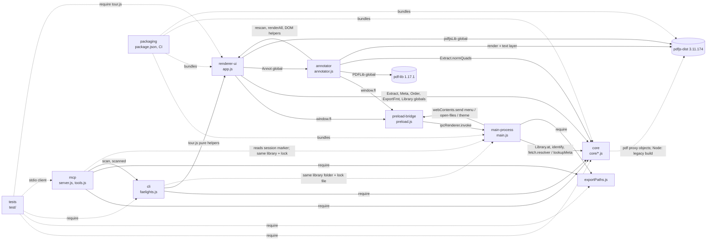

# Faelights — Codebase Atlas
> Last synced: 2026-10-21 · Synced at commit: 2620815

## How to read this
Layer 0 (this file) → module docs in [modules/](modules/) → file entries inside each module doc.
History, rationale and roadmap live in [../PROJECT_COMPASS.md](../PROJECT_COMPASS.md), not here.

Faelights is an Electron 31 desktop app with no bundler and no framework, plus a `faelights` command line and a `faelights-mcp` MCP server. A headless `core/` (extraction, topics, metadata, ordering, export, library store, identifiers, paper fetching) is shared by the renderer (as `<script>` globals), the main process and the CLI (through `require`). Tests are `node:test` files under `test/` (`npm test`). The renderer is plain browser scripts loaded by `<script>` tags in order; the main process is a single CommonJS file.

## Entry points
| Entry | File | What starts here |
|---|---|---|
| Electron main | `src/main.js` (`package.json` → `"main"`) | Single-instance lock, theme, app menu, splash + main `BrowserWindow`, all `ipcMain` channels |
| Splash | `renderer/splash.html` | Frameless window from `createSplash()`; destroyed by `revealMain()` |
| Preload | `src/preload.js` | Exposes `window.fl` bridge via `contextBridge` |
| Renderer page | `renderer/index.html` | Loads `pdf.min.js` → `pdf-lib.min.js` → `../core/topics.js` → `extract.js` → `meta.js` → `order.js` → `export.js` → `library.js` → `annotator.js` → `images.js` → `tour.js` → `app.js` |
| Renderer boot | `renderer/app.js` `boot()` IIFE | Loads DB + theme, renders UI, sends `app:ready`, consumes pending "Open with" files |
| OS file open | `src/main.js` `pdfArgs()`, `second-instance`, `open-file` | PDFs passed on the app's argv or macOS "Open with" |
| Command line | `cli/faelights.js` (`package.json` `bin.faelights`, `npm run cli`) | `main(argv)`: extract / export / text / info / list / search / add / rescan / lookup / library / move / tag / star / remove / theme / tour on the app's library folder |
| MCP server | `mcp/server.js` (`package.json` `bin.faelights-mcp`, `npm run mcp`) | stdio MCP server: `list_libraries`, `list_pdfs`, `get_extracts`, `search`, `export_pdf`, `export_library`, `add_pdf`, `tag_pdf`, `star_pdf`, resource `faelights://pdf/{id}` |
| CI build | `.github/workflows/build.yml` | On `v*` tag: `electron-builder` for win/mac/linux, files attached to a draft GitHub Release |
| Tests | `npm test` → `node --test "test/**/*.test.js"` | `test/core.test.js`, `test/images.test.js`, `test/identify.test.js`, `test/metadata.test.js`, `test/reader-images.test.js`, `test/export.test.js`, `test/tour.test.js`, `test/cli.test.js`, `test/core/{extract,topics,export,library,fetch}.test.js` |

## Module map

Two deliberate two-way edges: renderer-ui ↔ annotator (app.js opens/mounts the viewer; annotator calls app.js helpers and `rescan` at call time), and cli → renderer-ui's `tour.js` (pure step data only). The CLI, the MCP server and the main process never talk to each other; they share the files on disk, guarded by core `library.js`'s lock file. The MCP server also reads the app's session marker (`library/faelights.app`) and won't write while the app is open.

| Module | Path | Responsibility | Depends on | Used by | Doc |
|---|---|---|---|---|---|
| main-process | `src/main.js`, `src/exportPaths.js` | Splash/main windows, theme, dialogs, menus, shell, clipboard, exports (text + image assets, path-checked); the library store, identifier resolving and CrossRef/arXiv lookups through core, with Electron's `net` as the transport (the app's only network use) | electron (incl. `net`, `session`), core, node fs/path/crypto | preload-bridge (IPC), tests (`exportPaths.js`) | [main-process.md](modules/main-process.md) |
| preload-bridge | `src/preload.js` | Maps `window.fl.*` → IPC channels | electron `contextBridge`, `ipcRenderer`, `webUtils` | renderer-ui | [preload-bridge.md](modules/preload-bridge.md) |
| core | `core/` (`extract.js`, `topics.js`, `meta.js`, `order.js`, `export.js`, `library.js`, `identify.js`, `metadata.js`, `fetch.js`) | Headless: pdf.js document → entries, topics, loose marks, image boxes; PDF metadata; reading order + doc summary; export text/HTML; search matching; library db ops + on-disk store with lock; identifier parsing; paper resolving + details lookup over a passed-in transport | pdf.js document API (passed in), pdfjs-dist legacy (Node), node fs/path/os/crypto, Node `fetch` (`nodeGet`) | renderer-ui, annotator, main-process, cli, tests | [core.md](modules/core.md) |
| cli | `cli/faelights.js` | `faelights` command: read, search, add (files or identifiers), organise and rescan the app's library; theme and tour settings | core, renderer-ui `tour.js`, node fs/os/path/util | users, tests | [cli.md](modules/cli.md) |
| mcp | `mcp/server.js`, `mcp/tools.js` | `faelights-mcp`: stdio MCP server over core/ (read, search, export; three write tools that refuse while the app is open) | core, main-process `exportPaths.js`, cli `scan`/`scanned`, `@modelcontextprotocol/sdk`, `zod` | tests | [mcp.md](modules/mcp.md) |
| annotator | `renderer/annotator.js` | In-app PDF viewer; writes Highlight/Underline/StrikeOut/Text/Ink annotations and Square image boxes with pdf-lib into the library copy; undo/redo | pdf-lib, pdfjs-dist, preload-bridge, core (`Extract.normQuads`), renderer-ui helpers | renderer-ui | [annotator.md](modules/annotator.md) |
| renderer-ui | `renderer/app.js`, `images.js`, `tour.js`, `index.html`, `splash.html`, `styles.css`, `assets/brand/*`, `sample.pdf` | State, three-pane UI, splash page, brand artwork, theme button, search, image crops, exports, first-run guided tour, drag/drop, keyboard | preload-bridge, core, pdfjs-dist, @fontsource | — (top of stack); cli (`tour.js`) | [renderer-ui.md](modules/renderer-ui.md) |
| packaging | `package.json`, `.github/workflows/build.yml` | Dependencies, scripts, electron-builder config, CI release builds | electron-builder | — | [packaging.md](modules/packaging.md) |
| tests | `test/` | `node:test` suites: extraction snapshot and image boxes, core extract/topics/export/library/fetch (local server), identifier parsing, CrossRef/arXiv mapping, reader ordering, export formatting and path safety, tour data, the CLI as a child process | core, `src/exportPaths.js`, `renderer/tour.js`, cli, pdfjs-dist legacy build | `npm test` | [tests.md](modules/tests.md) |

## Key flows (code-level traces)

### Add a PDF (button, drag/drop, menu, or "Open with")
`chooseAndAdd()` (sidebar Add PDFs, list-header + button, empty state, menu) / window `drop` / `fl.onOpenFiles` / `boot()` pending → `app.js addPaths(paths)` →
existing `sourcePath` match? → `rescan()` (see below) ; else
`fl.importPdf(p)` → IPC `pdf:import` → `main.js` reads file, SHA-1 hash, writes `userData/library/files/<id>.pdf` → returns `{id, hash, storedPath, mtime…}` →
`fl.readPdf({...d, sourcePath:null})` → IPC `pdf:read` (reads stored copy) →
`app.js analyzeBytes()` → `pdfjsLib.getDocument` → `Meta.readMeta(pdf)` (`getMetadata` XMP + Info, page-1 text for DOI/arXiv) → `Extract.analyzePdf(pdf)` → `{entries, loose, topics, topicSource, pages, count, images}` →
`Order.summary()` adds `count`, `colours` → pushed to `S.db.docs` → `save()` (250 ms debounce) → `fl.saveDb` → IPC `db:save` → `main.js saveDb()` → core `store.saveDb` (lock file, atomic tmp+rename write of `faelights.json`).

### Add by identifier (DOI, arXiv, PMID, PMCID, ISBN, ADS Bibcode, link)
Sidebar/list-header link button / empty-state button / File → "Add by Identifier…" (`menu` `add-id`) / Ctrl+V outside inputs / dropped `text/uri-list` → `app.js openAddId(prefill)` → typing in the textarea → `addIdHint()` → `fl.parseIds` → IPC `id:parseMany` → `identify.parseIdentifiers` + `describe` → hint (one label, or "N recognised · M not recognised"; "Offline" pill when `navigator.onLine` is false) →
`submitAddId()` → offline? fail at once with `offline` ; one item → `fl.fetchPdf(text)` ; several → `addIdBatch(D)` runs the same call per item, one at a time, with a status row each (`addIdRow`) →
IPC `pdf:fetch` → core `fetch.js resolvePdf(id)` bound to `main.js fetchUrl` + `sendProgress` (`fetch-progress` `find` → `download`): arXiv / DOI (+ CrossRef fallback) / PMID (NCBI idconv → PMCID or DOI; eutils esummary → DOI) / ADS (arXiv bibcode → arXiv; link gateway EPRINT_PDF → PUB_PDF → ADS_PDF) / ISBN (Open Library public scan → archive.org PDF) / URL → `fetchUrl` on the `faelights-fetch` session → temp file → core `store.importPdf()` (`import`) → `{ok, info, origin, title}` →
duplicate by `origin` or `hash`? open the existing doc (single) / "already in library" row (batch) + `fl.removeStored(new copy)` ; else `addImported(info, target, {origin, title})` → `analyzeBytes` → `S.db.docs` → `save()`. Failures → `addIdFail(reason)` / failed row (Open in browser via `fl.openExternal`; Add PDFs from file… → `chooseAndAdd`). A batch with failures keeps the dialog open; otherwise it closes with "Added N PDFs".

### Capture an image box and show it
Viewer tool "Capture image" (`I`) → `annotator.js startBox` (drag preview `.pv-boxdraw`) → `edit([page], addAnnot(lib, i, "Square", {rect, c, width: 1.5}, {BS, CA, Subj: "Image"}))` → stored copy (see "Annotate a PDF") → `Annot.close()` → `rescan(d)` → `Extract.analyzePdf` collects Squares → `imgStreamAt` (reading-order position) → `imgSnapToFacts` (inside a fact → fact start) → `result.images` →
reader "With images" (`settings.images`) → `renderReader` → `Order.groupItems(withImages(filtered(d), filteredImages(d)))` (image before entry when `img.at <= e.at`; `S.off` colour filter applies) → `figureEl(d, img)` → `Images.crop(d, img)` → `fl.readPdf({...d, sourcePath:null})` → pdf.js render of the box region with annotations disabled → PNG data URL (cached per doc version) → centred `<figure>`.

### Item action menu
Right-click / ⋯ (`moreBtn`) / Shift+F10 or ContextMenu (`menuKey`) on a library row (`navItem` `onMenu`) or PDF card (`.doc-row`) → `libraryMenu(id, at, opts)` / `docMenu(d, at, opts)` → `openMenu(at, items, opts)` builds `.amenu` panels on `document.body` → the choice resolves the Promise → same action handlers as before (`exportLibrary`, `deleteLibrary`, `annotate`, `setMine`, `moveDoc`, `removeDoc`…). The reader's library button uses `openMenu` with a "Move to" heading.

### Startup + staleness detection
`main.js whenReady` → `loadTheme()` reads `userData/theme.json` → `nativeTheme.themeSource` → `createSplash()` (shown on `ready-to-show`) + `createWindow()` (hidden) →
`app.js boot()` → `fl.loadDb()` + `fl.getTheme()` → IPC `db:load` → `main.js loadDb()` (repairs missing Inbox/settings; backs up unparseable file as `.broken-<ts>`) → for every doc `statOrNull(sourcePath)` sets `sourceMissing` and `stale` (mtime > `scannedMtime` + 1 s) → renderer `renderAll()` → `fl.ready()` → IPC `app:ready` → `main.js revealMain()` (keeps the splash up ≥ `SPLASH_MIN_MS` 2.3 s, then shows main and destroys splash; `SPLASH_MAX_MS` 8 s timer forces it) → `fl.pendingFiles()` → IPC `app:pending` drains `pendingOpen` → `addPaths()`.

### Rescan a changed PDF
`openDoc(id)` (if `d.stale && d.sourcePath`, or `outdated(d)`: result `v` < `ANALYZER_VERSION`) / doc menu "Rescan" / `rescanAll()` (stale or outdated docs, else all) → `app.js rescan(d)` → `fl.readPdf(d)` → IPC `pdf:read`: if original exists read it, and if newer than `scannedMtime` overwrite stored copy; else read stored copy → `analyzeBytes()` → `Extract.analyzePdf()` → doc fields replaced, `stale=false` → `save()`.

### Extraction pipeline (inside `core/extract.js analyzePdf`)
per page: `getTextContent()` + `getAnnotations()` → keep Highlight/Underline/Squiggly/StrikeOut (`MARK_TYPES`) → `normQuads()` + `colorOf()` → build one char stream with line/paragraph breaks and de-hyphenation → per-char quad hit-test assigns annotation id → topics (`core/topics.js buildTopics`), first that succeeds: `resolveOutline()` (bookmarks, `topicSource:"outline"`) → font-size headings (`"headings"`) → if < 2, `patternTopics()` by wording (`"patterns"`) → `pageTopics()` one per page (`"pages"`) → snap highlight edges to whole words → `sentenceBounds()` (abbreviation-aware) → group & merge overlapping sentences → entries `{n, page, at, segs, spans, topic, sentence}`; annotations with no text hit go to `loose`. Result is stamped `v: ANALYZER_VERSION`. Entries before the first topic have `topic: null` and render under `PRE_TOPIC` ("Abstract") in `app.js`.

### Export
Reader "Export" → `exportMenu(d, eb)` (Markdown / Obsidian / HTML / Plain text; "Include images" toggles `settings.images`) / menu `export-doc` → `exportDoc(d, fmt)`:
no images and not html → `docText(d, fmt, frontmatter)` (`ExportFmt.docText`: `groupsOf`, `entryLines`, `settings.mode`) → `fl.exportFile` → IPC `export:file` save dialog → write (output identical to before F-016) ;
html → `exportImages` (data URLs via `Images.crop`) → `ExportFmt.docHtml` → `fl.exportBundle` ; md/obsidian/plain with images → `exportImages` (`Images.png` per box, "Preparing images… k/n" toast, failed crop → placeholder line) → `ExportFmt.docText(…, {images})` (`exportItems` → `Order.withImages`; `imageLines` per format, paths under a random `dirToken`) → `fl.exportBundle` → IPC `export:bundle` → save dialog → `exportPaths.imagesDirFor` (`<file base> images`) → `fillToken` / `planAssets` (rejects unsafe paths) → `writeAtomic` assets, then the text file.
Library menu / menu `export-library` → `exportLibrary(id)` → per doc the same text/html builders (images under `<doc file base> images/` when on) → `fl.exportFolder(name, files, assets)` → IPC `export:folder` (every name checked by `exportPaths`) → writes `<dir>/<library name>/…` → `fl.openFolder`.
Copy → `docText(d, fmt, false, filtered(d), filteredImages(d) when "With images" is on)` → `[Image, p. N]` placeholders → `fl.copy`.

### Column resize / collapse
Pointer down on a `.resizer[data-pane]` (window-level listener in `app.js`) → `pointermove` sets `layout()[pane].w` (clamped to `PANES` min/max) or `closed` when dragged below ~half the minimum → `applyLayout()` writes `--side-w/--list-w/--rail-w` and `*-closed` classes on `#app` (borrowing width from list then sidebar so the reader keeps `READER_MIN`) → `pointerup` → `save()`. Hide buttons (`paneBtn`), strips (`strip`), focused-handle keys (`resizerKey`), double-click (reset one pane) and menu `pane:*` / `layout-reset` all end in `togglePane()` / `resetLayout()` → `applyLayout()` + `save()`. No pane re-renders.

### Info card (PDF metadata)
Reader `.info-btn` (labelled "Metadata", left of the Full sentence / Highlights only switch) → toggles `settings.info` → `save()` + `renderReader()` → `infoEl(d)` prepended to `.r-main` → renders `d.meta` via `infoRows()`; if `d.meta` is missing → `loadMeta(d)` → `fl.readPdf({...d, sourcePath:null})` → `readMeta()` → `d.meta` → `save()` → `renderReader()`. `rescan()` also refreshes `d.meta` (not `d.lookup`). The card shows `metaOf(d)` = `d.meta` overlaid with `d.lookup.meta`.

### Look up paper details (CrossRef / arXiv)
Info card "Look up details" / "Refresh details" → `app.js lookUp(d)`; or `addImported(…, {origin})` after an add by identifier → `lookUp(d, true)` (no toasts) → `lookupQuery(d)` (`d.meta.doi`/`arxiv`, `d.origin`) → offline? stop → `fl.lookupMeta(q)` → IPC `meta:lookup` → core `lookupMeta(fetchUrl, …)` → `lookupTarget` → `fetchUrl(…, {signal, quiet})` CrossRef `works/<doi>` → `fromCrossref` | arXiv `api/query` → `fromArxivAtom` → `{ok, meta, source, id}` → `d.lookup = {source, id, at, meta}` (+ `d.title` if the PDF had none and `!d.titleEdited`) → `save()` → `renderAll()`.

### Copy a captured image
Reader figure Copy button / right-click → "Copy image" → `app.js copyImage(d, img)` → `Images.png(d, img)` (PNG bytes from the cached crop) → `fl.copyImage` → IPC `clip:image` → `nativeImage.createFromBuffer` → `clipboard.writeImage` → toast "Image copied".

### Annotate a PDF
Reader toolbar "View" button (first in the left-aligned `.r-tools`, before Info) / doc menu "Annotate" / clicking an extract's `p. N` → `app.js annotate(d, page)` → `Annot.open(d, page)` → `fl.readPdf(d)` (stored copy if `d.annotated`) → pdf.js doc + `PDFDocument.load` (pdf-lib, in the background) → `renderReader()` → `Annot.mount(#reader)` → pages drawn lazily (`drawPage`: canvas with `AnnotationMode.ENABLE` + `renderTextLayer`).
Edit (text selection + tool/popover, note click, ink drag, recolour, note, delete) → `edit(pages, fn)` on a serial queue → pdf-lib mutation (`addAnnot` / `recolorAnnot` / `setNote` / `deleteAnnot`, each writing an `/AP` stream) → `lib.save()` → push `{bytes, pages}` on `undo` → `swap()`: new pdf.js doc, bump `pageVer` for those pages, redraw them → `persist()`: `d.annotated = true`, `fl.writeStored(d.storedPath, bytes)` → IPC `pdf:writeStored` (atomic write inside `FILES_DIR`) + `save()`.
Undo/redo → `history()` swaps byte snapshots (pdf-lib doc reloaded lazily). "Download PDF" → `fl.savePdfAs` → IPC `pdf:saveAs`.
Leave (back button / Esc / another doc / search) → `Annot.close()` → after `queue` + `writing` settle → `rescan(d)` → `pdf:read` returns the stored copy → `analyzePdf` → new marks appear as extracts. Doc menu "Discard annotations made here…" → `useOriginal(d)`: `annotated=false`, `scannedMtime=0`, `rescan` → `pdf:read` re-copies the original over the stored copy.

### Theme change
Sidebar footer `themeSwitch()` (monitor / sun / moon icons, one click each) → `fl.setTheme(t)` → IPC `theme:set` → `main.js applyTheme(t)` sets `nativeTheme.themeSource`, `setBackgroundColor` on every window, writes `userData/theme.json`, rebuilds the menu, pushes `theme` → `fl.onTheme` → `S.theme`, `renderSide()`. View → Theme radio items call `applyTheme` directly. All styling and `<picture>` brand art react through `prefers-color-scheme`.

### First-run guided tour
`boot()` → after 900 ms `maybeTour()` (also `tourSoon()` at the end of `renderReader` and after `annotate`) → picks the first chapter with a pending step whose target is on screen: `app`, else `viewer` if `Annot.isOpen()`, else `reader` (`Tour.ready(Tour.pending(S.db.settings, ch))`) → `startTour(ch)` → `Tour.start(ch, {steps: pending})` → overlay spotlights each step's `[data-tour]`/class target, skipping ones not on screen → each shown step `Tour.markShown` → `save()` (`settings.tour[ch]` = shown ids). Skip tour / Esc → `Tour.skipAll` (every chapter `true`). Finishing `app` → `tourSoon()` so an open PDF continues into `reader`. Steps skipped for a missing target stay pending and run as a short follow-up the first time it appears. Help › Show Tour → menu `tour` → `settings.tour = {}` → `startTour("app")`.

### Command line: add a paper by identifier
`faelights add 10.1371/… -l Thesis -t insects` → `cli/faelights.js main` → `parse` → `Library.at(--data-dir | userDataDir())` → `cmdAdd`: each arg is a `.pdf` on disk or `identify.parseIdentifier` (else exit 2) → `findLibrary` → `sameOrigin(db, id)`? "Already in your library" ; else `fetch.resolver(nodeGet()).resolvePdf(id)` (same resolver as the app; cookies per `Domain=`) → temp file → `store.importPdf` (`sourcePath: null`, `fileNameFor`) → same `hash` already there? `removeStored` ; else `scan(bytes)` (`Extract.openPdf` → `Meta.readMeta` + `Extract.analyzePdf`) → doc `{…addImported fields, origin, tags}` → `fetchDetails` → `fetch.lookupMeta` → `applyDetails` (`d.lookup`, title if none) → `store.update(db => db.docs.push(d))` (lock, read-modify-write) → stdout line + "restart the app" note on stderr.
Other library commands (`move`, `tag`, `star`, `library …`, `remove`, `rescan`, `tour skip|restart`) are one `store.update(fn)` each, looking the doc/library up inside `fn`. `search` reads with `loadDb` and filters entries with `Library.entryMatches` (the app's `renderResults` uses the same function).

### MCP: a write tool while the app may be open
Client `tools/call star_pdf` → `mcp/server.js` zod check → `wrap(tools.star_pdf)` → `write(fn)` → `writable()`: `store.appSession()` reads `library/faelights.app`. If a live pid other than this one holds it → `library_in_use`. Otherwise → `store.update(fn, {wait: 0})` (lock file held → `ELOCKED` → `library_in_use`) → `Library.findDoc` / `setStar` → atomic write → JSON result. The app writes the marker in `main.js` `whenReady` (`store().openSession()`) and removes it on `will-quit` (`closeSession()`). A marker whose pid is dead is ignored.
Reads (`get_extracts`, `export_pdf`, the resource) → `readable(id)` → `store.checkSources(loadDb())` → `resultOf(d)` (saved result, or in-memory re-read when missing, outdated or stale) → `checkText` (`result.textless`) → grouped by `ExportFmt.groupsOf` / rendered by `ExportFmt.docText`.

## Cross-cutting couplings
| Kind | Key | Producers | Consumers |
|---|---|---|---|
| IPC invoke | `db:load`, `db:save`, `app:pending` | `preload.js` | `main.js` |
| IPC invoke | `pdf:choose`, `pdf:import`, `pdf:read`, `pdf:stat`, `pdf:open`, `pdf:reveal`, `pdf:relink`, `pdf:removeStored`, `pdf:writeStored`, `pdf:saveAs` | `preload.js` | `main.js` |
| IPC invoke | `export:file`, `export:folder` (+ `assets`), `export:bundle`, `export:openFolder`, `clip:write`, `clip:image`, `menu:popup`, `ask:confirm` | `preload.js` | `main.js` |
| IPC invoke | `theme:get`, `theme:set` | `preload.js` | `main.js` |
| IPC invoke | `id:parse`, `id:parseMany`, `pdf:fetch`, `pdf:fetchCancel`, `meta:lookup`, `app:openExternal`, `clip:read` | `preload.js` | `main.js` |
| IPC push | `fetch-progress` (`{stage}`) | `main.js sendProgress` | `app.js fl.onFetchProgress` |
| Network | arxiv.org, export.arxiv.org, doi.org (+ publisher redirects), api.crossref.org, pmc.ncbi.nlm.nih.gov, eutils.ncbi.nlm.nih.gov, ui.adsabs.harvard.edu (+ redirects), openlibrary.org, archive.org — only from `pdf:fetch` / `meta:lookup` and CLI `add <identifier>` / `lookup` | core `fetch.js` over `main.js fetchUrl` (app) or `nodeGet` (CLI) | — |
| Session partition | `faelights-fetch` (in-memory) | `main.js fetchUrl` | — |
| Temp file | `<temp>/faelights-<random>.pdf` (deleted after import) | `main.js` `pdf:fetch`, CLI `add <identifier>` | core `store.importPdf` |
| String keys | fetch failure reasons (`invalid`, `offline`, `network`, `not-found`, `paywalled`, `not-pdf`, `too-large`, `no-free-copy`, `cancelled`) | core `fetch.js FetchFail`, `identify.fetchFailureReason` | `app.js ADD_FAIL` / `ADD_OPEN`, CLI `ADD_FAIL` |
| Doc field | `origin` `{kind: doi|arxiv|pmcid|pmid|isbn|ads|url, value, url}` | `app.js addImported` (from `pdf:fetch`), CLI `add <identifier>` | `app.js submitAddId` / CLI `add` duplicate check; `lookupQuery` / CLI `fetchDetails` |
| IPC send (renderer → main) | `app:ready` | `app.js boot()` via `fl.ready()` | `main.js revealMain()` |
| IPC push | `menu` (payloads: `add`, `add-id`, `new-library`, `export-doc`, `export-library`, `rescan-all`, `search`, `toggle-mode`, `pane:side`, `pane:list`, `pane:rail`, `layout-reset`) | `main.js buildAppMenu()` | `app.js fl.onMenu` handler |
| IPC push | `open-files` | `main.js` `second-instance` / `open-file` | `app.js fl.onOpenFiles` → `addPaths` |
| IPC push | `theme` (`system`/`light`/`dark`) | `main.js applyTheme()` | `app.js fl.onTheme` |
| Persisted file | `userData/theme.json` (`{theme}`) | `main.js applyTheme`, `cli theme` | `main.js loadTheme` at startup, `cli theme` |
| Persisted file | `userData/library/faelights.json` (`{version, libraries, docs, settings}`) | core `store.saveDb` (whole object from the renderer, via `main.js`), core `store.update` (CLI read-modify-write) | core `store.loadDb` → `main.js db:load` → renderer `S.db`; CLI |
| Lock file | `userData/library/faelights.json.lock` (`{pid, at}`, `wx`; stale after 30 s; wait ≤ 10 s, or `opts.wait` (MCP: 0) → `ELOCKED`) | core `store.withLock` (every save/update: app, CLI, MCP) | same |
| Session marker | `userData/library/faelights.app` (`{pid, at}`) | `main.js` `whenReady` → `store.openSession()`; removed on `will-quit` by `closeSession()` (own pid only) | `mcp/tools.js writable()` via `store.appSession()` (live pid → `library_in_use`) |
| Persisted dir | `userData/library/files/<docId>.pdf` | core `store.importPdf` / `readPdf` (refresh) / `writeStored` (via IPC `pdf:import`, `pdf:read`, `pdf:writeStored`; CLI `add`, `rescan`) | `pdf:read`, `pdf:open`, `pdf:reveal`, CLI `text` / `rescan`; deleted by `store.removeStored` (`pdf:removeStored`, CLI `remove`) |
| Doc flag | `annotated` (+ `annotatedAt`) | `annotator.js persist()`; cleared by `app.js useOriginal()` | `main.js` `pdf:read` (stored copy only) and `db:load` (never stale); `app.js` list pill + doc menu |
| Global (window) | `PDFLib` | `pdf-lib.min.js` script tag | `annotator.js` |
| Global (window) | `Annot` | `annotator.js` | `app.js renderReader`, `annotate`, `openDoc`, `removeDoc`, `useOriginal`, keydown |
| Global (window) | `Extract` (`analyzePdf`, `ANALYZER_VERSION` (3), `normQuads`, `imgStreamAt`, `imgSnapToFacts`, `highlights`) | `core/extract.js` (needs `Topics` from `core/topics.js`) | `app.js analyzeBytes`, `outdated()`; `annotator.js pickAt` (`normQuads`) |
| Global (window) | `Meta` (`readMeta`, `cleanTitle`) | `core/meta.js` | `app.js` (`analyzeBytes`, `loadMeta`, `lookUp`, info card) |
| Global (window) | `Library` (pure db ops, `entryMatches`) | `core/library.js` | `app.js` libraries, tags, stars, move, search |
| Global (window) | `pdfjsLib` | `pdf.min.js` script tag | `app.js` (`GlobalWorkerOptions`, `getDocument`) |
| Global (window) | `Images` | `images.js` | `app.js figureEl`, `exportImages`, `removeDoc`, `rescan` |
| Global (window) | `Order` | `core/order.js` | `app.js renderReader` / `filteredImages` / `withImages` / `summary`, `core/export.js` |
| Global (window) | `Tour` | `tour.js` | `app.js` guided-tour section (`startTour`, `maybeTour`) |
| DOM hooks | `data-tour="…"` attributes (`add`, `add-id`, `search`, `all`, `starred`, `mine`, `libraries`, `foot`, `pane`, `list-tools`, `start`, `view`, `copy`, `export`, `pv-back`, `pv-dl`) | `app.js`, `annotator.js` | `tour.js CHAPTERS` selectors (checked by `test/tour.test.js`) |
| Settings key | `settings.tour` (`{app\|reader\|viewer: [shown step ids] or true}`; no main default) | `app.js startTour` via `Tour.markShown` / `skipAll`; menu `tour` resets to `{}`; CLI `tour skip` / `restart` | `app.js maybeTour` via `Tour.pending`; CLI `tour status` |
| Menu channel | `tour` (Help › Show Tour) | `main.js` app menu | `app.js fl.onMenu` |
| Global (window) | `ExportFmt` | `core/export.js` | `app.js` export section (`wrapHl`/`entryLines`/`groupsOf` are aliases) |
| Result field | `result.images[]` `{id, n, page, rect, color, comment, at, topic}` | `core/extract.js analyzePdf` | `core/order.js`, `images.js`, `core/export.js`, `app.js`, CLI `info` |
| PDF annotation | `Square` (`/Subj (Image)`, border-only) = image box | `annotator.js startBox` (or other apps) | `core/extract.js` (`images`), `images.js` (crop by `/Rect`) |
| Placeholder token | random `dirToken` in export text / asset paths | `app.js exportDoc` | `main.js export:bundle` (`exportPaths.fillToken`) |
| Result field | `result.textless` (pages with no text layer; absent on older scans) | `core/extract.js analyzePdf` | `mcp/tools.js checkText` (`no_text_layer` / warnings) |
| Result version | `result.v` | `core/extract.js analyzePdf` | `app.js outdated()` → rescan on open / Rescan all; CLI `rescan` / `export` warning |
| Global (window) | `fl` | `preload.js` | `app.js` everywhere |
| Magic id | library id `"inbox"` (`system: true`) | `main.js EMPTY_DB/loadDb` | `app.js` (default target, delete fallback, boot) |
| Drag MIME | `application/x-faelights-doc` | `app.js renderDocs` dragstart | `app.js navItem` drop on library |
| Relative paths | `../node_modules/pdfjs-dist/build/*.min.js`, `../node_modules/pdf-lib/dist/pdf-lib.min.js`, `../node_modules/@fontsource/*` | `package.json build.files` | `index.html`, `app.js` worker src, `styles.css @import` |
| Brand asset paths | `assets/brand/{mark,mote,splash}-{light,dark}.svg`, `favicon-*.ico`, `app-icon.png`, `app-icon.ico` | files in `renderer/assets/brand/` | `app.js brandImg()`, `index.html`, `splash.html`, `main.js ICON` |
| Media query | `prefers-color-scheme` | `nativeTheme.themeSource` (main) | `styles.css`, `splash.html`, `<picture>` sources |
| Settings keys | `settings.mode` (`full`/`only`), `fmt` (`md`/`obsidian`/`html`/`plain`), `sort` (`added`/`title`/`count`) | `main.js EMPTY_DB` defaults | `app.js` reader, export, list |
| Doc flag | `mine` ("My publications") | `app.js setMine` (doc menu, reader toggle, drop on sidebar item) | `app.js visibleDocs` (`view.kind === "mine"`), sidebar count |
| Settings key | `settings.info` (boolean; no main default) | `app.js` info toggle | `app.js renderReader()` |
| Settings key | `settings.images` (boolean "With images"; no main default) | `app.js` reader toggle, `exportMenu` | `app.js renderReader`, `exportWithImages`, Copy |
| Settings key | `settings.annotColor` (`[r,g,b]` 0–1; no main default, falls back to yellow) | `annotator.js` swatches / popover | `annotator.js color()` |
| Settings key | `settings.layout` (`{side,list,rail: {w, closed}}`; no main default, filled by `app.js layout()`) | `app.js` drag / toggle / `resetLayout` | `app.js applyLayout()` |
| CSS vars + classes on `#app` | `--side-w`, `--list-w`, `--rail-w`; `side-closed`, `list-closed`, `rail-closed`, `wide` | `app.js applyLayout()`, `renderList()` | `styles.css` grid, strips, `.app > .resizer` positions |
| Env vars | `FAELIGHTS_DATA_DIR`, `APPDATA`, `XDG_CONFIG_HOME` (only when no folder is passed) | — | core `library.js userDataDir()` (CLI and MCP server; the app passes `app.getPath("userData")`) |

## Conventions
- All filesystem, dialog, shell and clipboard access stays in `main.js` behind an `ipcMain.handle`. The renderer runs with `contextIsolation: true`, `nodeIntegration: false` and `sandbox: true`, and only reaches the OS through `window.fl`.
- Adding an OS capability takes three edits: `ipcMain.handle("<area>:<verb>")` in `main.js`, a `fl.<name>` wrapper in `preload.js`, and the call site in `app.js`.
- `core/` has no DOM, no `fl`, no Electron. Browser-loadable files expose exactly one global (`Extract`, `Topics`, `Meta`, `Order`, `ExportFmt`, `Library`) and end with a `module.exports` guard; they find each other as globals first, `require` second. Node-only core files (`identify`, `metadata`, `fetch`) are plain CommonJS. Network code in core takes the transport as a parameter.
- Logic the app and the CLI both need goes in `core/` and both call it (doc summary, metadata, search matching, resolving papers), so their doc records stay identical.
- Every CLI or MCP change to the library is one `store.update(fn)`; never `saveDb` from either. MCP write tools also check `store.appSession()` first and use `{wait: 0}`.
- The MCP server never writes to stdout: `server.js` sends `console.log` to stderr before loading anything.
- The renderer is immediate-mode: mutate `S` / `S.db`, call `save()`, then `renderAll()` (or `renderSide`/`renderList`/`renderReader`). There is no diffing.
- IDs: docs `"d" + base36 time + random`, libraries `"l" + base36 time`.
- CSS uses custom properties on `:root`, with a dark override under `prefers-color-scheme: dark`. Never add a theme class: the light/dark choice is made only through `nativeTheme.themeSource` in `main.js`.
- Light/dark artwork goes in `renderer/assets/brand/` as `<name>-light.svg` / `<name>-dark.svg` and is placed with `brandImg(name)` (or a `<picture>` in static HTML).
- Bump `ANALYZER_VERSION` in `core/extract.js` whenever extraction output changes, so saved docs rescan.
- Pure logic that tests need goes in `core/` (or, for UI-only pieces like the tour, its own renderer script with a `module.exports` guard), loaded before `app.js`; main-only pure helpers go in their own CommonJS file (`exportPaths.js`).
- Paths that come from the renderer (export names, asset paths) are validated in main with `exportPaths` before any write.
- PDF bytes are only ever written to the stored copy (`pdf:writeStored`) or a user-chosen path (`pdf:saveAs`), never to `sourcePath`.

## File → module index
| File | Module |
|---|---|
| `.github/workflows/build.yml` | packaging |
| `build/icon.ico` | packaging |
| `build/icon.png` | packaging |
| `cli/faelights.js` | cli |
| `core/export.js` | core |
| `core/extract.js` | core |
| `core/fetch.js` | core |
| `core/identify.js` | core |
| `core/library.js` | core |
| `core/meta.js` | core |
| `core/metadata.js` | core |
| `core/order.js` | core |
| `core/topics.js` | core |
| `mcp/server.js` | mcp |
| `mcp/tools.js` | mcp |
| `package.json` | packaging |
| `renderer/annotator.js` | annotator |
| `renderer/app.js` | renderer-ui |
| `renderer/assets/brand/*` | renderer-ui |
| `renderer/images.js` | renderer-ui |
| `renderer/index.html` | renderer-ui |
| `renderer/sample.pdf` | renderer-ui |
| `renderer/splash.html` | renderer-ui |
| `renderer/styles.css` | renderer-ui |
| `renderer/tour.js` | renderer-ui |
| `scripts/set-exe-icon.js` | packaging |
| `src/exportPaths.js` | main-process |
| `src/main.js` | main-process |
| `src/preload.js` | preload-bridge |
| `test/README.md` | tests |
| `test/cli.test.js` | tests |
| `test/core.test.js` | tests |
| `test/core/export.test.js`, `extract.test.js`, `fetch.test.js`, `library.test.js`, `topics.test.js` | tests |
| `test/export.test.js` | tests |
| `test/fixtures/images.pdf`, `test/fixtures/make-images-pdf.js` | tests |
| `test/helpers/annotate.js`, `test/helpers/pdf.js` | tests |
| `test/identify.test.js` | tests |
| `test/images.test.js` | tests |
| `test/mcp.test.js` | tests |
| `test/metadata.test.js` | tests |
| `test/reader-images.test.js` | tests |
| `test/tour.test.js` | tests |

## Excluded
`node_modules/`, `dist/` (gitignored build output), `package-lock.json`, `README.md`, `.gitignore`.
