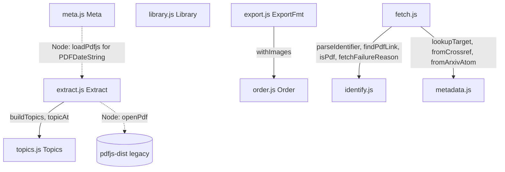

# Module: core
> Path: core/ (extract.js, topics.js, meta.js, order.js, export.js, library.js, identify.js, metadata.js, fetch.js) · Last synced commit: 2620815 · Related features: F-001, F-002, F-006, F-007, F-011, F-012, F-014, F-015, F-016, F-020, F-023, F-024

## Purpose
This is the headless, framework-free core: PDF highlight extraction, topic detection, PDF metadata, reading order with images, export formatting, search matching, the library on disk, identifier parsing, and finding/downloading papers. It has no DOM, no IPC and no Electron. The browser-loadable files (`extract`, `topics`, `meta`, `order`, `export`, `library`) load two ways: through a `<script>` tag in the renderer, where each defines one global namespace, and through `require()` in plain Node (main process, CLI, tests). The fs half of `library.js` is Node-only; the renderer only uses its pure db operations. `identify.js`, `metadata.js` and `fetch.js` are plain CommonJS, used only from Node (main process and CLI).

## Public interface
- **`Extract`** (`core/extract.js`)
  - `analyzePdf(pdf, onProgress?)` → `{ v, entries, loose, topics, topicSource, pages, count, images, textless }` (`textless`: page numbers with no text layer) on any pdf.js document
    - `entries[]`: `{ n, page, at, segs:[{t, hl}], spans:[{id, color, type, comment, text}], topic, sentence }`
    - `loose[]`: `{ page, color, type, comment }` for marks with no text under them
    - `topics[]`: `{ title, path[], level, page, at }`; `topicSource` `"outline"` | `"headings"` | `"patterns"` | `"pages"`
    - `images[]`: `{ id, n, page, rect, color, comment, at, topic }` from every `Square` annotation, sorted by `at`, then top-to-bottom and left-to-right. Not counted in `count`, never in `loose`
    - `onProgress(page, numPages)` once per page
  - `highlights(result)` → one row per mark in reading order: `{ n, page, type, color, comment, text (highlighted words only), sentence, topic: path[] | null }`
  - `ANALYZER_VERSION` (3), `MARK_TYPES`, `normQuads(a)`, `colorOf(a)`, `imgStreamAt(im, lines, textLen)`, `imgSnapToFacts(imgs, groups)`
  - Node only: `loadPdfjs()` (lazy `require("pdfjs-dist/legacy/build/pdf.js")`, with the "Cannot polyfill" canvas warning silenced), `openPdf(pathOrBytes)` → pdf.js document (no worker, font faces off), `extractPdf(pathOrBytes, {onProgress})` → open + `analyzePdf` + destroy
- **`Topics`** (`core/topics.js`): `buildTopics(pdf, lines, text, sizeHist)` → `{topics, topicSource}` (sorted by `at`); `resolveOutline(pdf)`, `headingTopics(lines, text, body)`, `patternTopics(lines, text)`, `pageTopics(lines)`, `topicAt(topics, at)`
- **`Meta`** (`core/meta.js`): `readMeta(pdf)` → `{title, authors[], abstract, publication, volume, issue, pages, date, doi, arxiv, issn, isbn, publisher, url, rights, keywords[], creator, producer, created, modified, pdfVersion}` (XMP dc/prism → Info dict → DOI/arXiv regex on page 1; empty fields dropped), `cleanTitle(t)` (drops `Microsoft Word - `, file extensions, `untitled`, < 3 chars → `""`), `DOI_RE`, `ARXIV_RE`
- **`Order`** (`core/order.js`): `ckey(color)`, `imagesOf(result)`, `filterImages(images, offSet)`, `withImages(entries, images)` (an image goes before an entry when `img.at <= e.at`), `groupItems(items)`, `summary(result)` → `{count, colours}` (the doc's list fields: marks incl. loose; up to 6 colours, extracts then images)
- **`ExportFmt`** (`core/export.js`): `PRE_TOPIC`, `FORMATS`, `extOf(fmt)`, `wrapHl`, `entryLines`, `groupsOf`, `exportItems`, `isImage`, `imageFile(img)`, `mdLink(path)`, `imageLines(ref, fmt)`, `safeName(title)` / `fileBase(title)` (export file names; `fileBase` also safe on Windows), `docText(d, {fmt, mode, frontmatter, libraryName, date, preTopic, entries, images})`, `esc`, `docHtml(d, opts)`
- **`Library`** (`core/library.js`)
  - pure (renderer + Node): `EMPTY_DB()`, `normalize(db)`, `findDoc`, `findLibrary`, `docsIn(db, libId)`, `addLibrary(db, name?)`, `renameLibrary(db, id, name)`, `removeLibrary(db, id)` (docs → Inbox; refuses system), `moveDoc(d, libId)`, `cleanTag`, `addTag(d, tag)` → the added tag or `""`, `removeTag(d, tag)`, `tagCounts(db)` → `Map`, `setStar(d, on?)` (toggles when `on` is omitted), `searchTerms(q)` (lower-cased words), `entryMatches(e, terms)` (every term in the sentence, a span's text or comment, or the topic path), `INBOX`, `APP_NAME`
  - Node only: `userDataDir(env?, platform?, home?)` (`FAELIGHTS_DATA_DIR`, else `%APPDATA%\Faelights`, `~/Library/Application Support/Faelights`, `$XDG_CONFIG_HOME|~/.config/Faelights`); `at(userData?)` → a store (one per folder per process): `paths {userData, dir, db, files, lock, session}`, `loadDb()`, `saveDb(db)`, `update(fn, opts?)`, `withLock(fn, opts?)` (`opts.wait` ms before `ELOCKED`, default 10 s; 0 = fail at once), `openSession()` / `closeSession()` / `appSession()` (the desktop app's `faelights.app` marker; `appSession()` → `{pid, at}` only for a live process other than this one), `checkSources(db)`, `isStored(p)`, `importPdf(srcPath)`, `readPdf(doc)`, `pdfPath(doc)`, `writeStored(storedPath, bytes)`, `removeStored(storedPath)`

- **identify** (`core/identify.js`, CommonJS): `parseIdentifier(text)` → `{kind: doi|arxiv|pmcid|pmid|isbn|ads|url, value, url}` | `null`, `parseIdentifiers(text)` → `[{text, id}]`, `describe(id)`, `findPdfLink(html, baseUrl)` → `{pdf, refresh, title}`, `isPdf(buf)`, `fileNameFor(id, pdfUrl)`, `fetchFailureReason(err)` → `offline` | `network`
- **metadata** (`core/metadata.js`, CommonJS): `lookupTarget(meta, origin)` → `{source: crossref|arxiv, id}` | `null`, `fromCrossref(json)`, `fromArxivAtom(xml)` (both → the `Meta.readMeta` field shape, plus `itemType`)
- **fetch** (`core/fetch.js`, CommonJS, Node only)
  - `FetchFail(reason)`; reasons `invalid`, `offline`, `network`, `not-found`, `paywalled`, `not-pdf`, `too-large`, `no-free-copy`, `cancelled`; `statusFail(status)`, `hardFail(e)`; constants `ACCEPT_ANY`, `MAX_PDF` (150 MB), `MAX_HTML` (5 MB), `FETCH_HEAD_MS` (15 s), `FETCH_STALL_MS` (30 s)
  - `resolver(get, progress?)` → `{resolvePdf(id), pdfFrom(url, hops), fetchJson(url)}`. `get(url, accept, maxBytes, opts)` is the transport → `{url, type, html, buf}`; `progress({stage: find|download})`. `resolvePdf`: arXiv → `arxiv.org/abs` then `/pdf`; DOI → `doi.org` landing page → `citation_pdf_url`, then CrossRef `works/<doi>` `link[]` PDFs, else `paywalled`; PMID → NCBI idconv → PMCID or DOI (eutils esummary fallback), else `no-free-copy`; ADS → arXiv bibcodes to arXiv, else link gateway `EPRINT_PDF` → `PUB_PDF` → `ADS_PDF`; ISBN → Open Library public scan → `archive.org/download` (≤ 5 scans); URL → as given
  - `lookupMeta(get, {doi, arxiv}, origin, opts)` → `{ok, meta, source, id}` | `{ok: false, reason}` (CrossRef `api.crossref.org/works/<doi>` or `export.arxiv.org/api/query`; `cancelled` → `network`)
  - `nodeGet({userAgent, signal, onProgress})` → a transport on Node's `fetch`: manual redirects (≤ 10, each http(s)), a cookie jar per transport that honours `Domain=`, status → reason via `statusFail`, size cap and stall timeout

## Dependencies
- **Uses:** the pdf.js document API passed in (`numPages`, `getPage`, `getTextContent`, `getAnnotations`, `getOutline`, `getDestination`, `getPageIndex`); pdfjs-dist 3.11.174 legacy build (Node: `openPdf`, and `PDFDateString` in `meta.js` when there is no `pdfjsLib` global); node `fs`, `path`, `os`, `crypto` (`library.js` store, required lazily); Node's global `fetch` (`nodeGet`)
- **Used by:** renderer-ui (`Extract.analyzePdf`, `ANALYZER_VERSION`, `Meta.readMeta` / `cleanTitle`, `Order` incl. `summary`, `ExportFmt`, `Library` pure ops incl. `entryMatches`), annotator (`Extract.normQuads`), main-process (`Library.at(app.getPath("userData"))`, `identify`, `fetch.resolver` / `lookupMeta` with its Electron transport), cli (all of them, plus `fetch.nodeGet`), tests

## Internal structure

In the browser, a dependency is found as a global (`typeof Topics !== "undefined" ? Topics : require("./topics.js")`). `index.html` therefore loads `topics.js` before `extract.js` and `order.js` before `export.js`; `meta.js` follows `extract.js` and only needs the `pdfjsLib` global.

## Data & state owned
- `library.js` reads and writes `<userData>/library/faelights.json` (`{version, libraries, docs, settings}`), `faelights.json.lock` (`{pid, at}`, only while writing), `faelights.json.<pid>-<hex>.tmp` (during a write), `faelights.json.broken-<ts>` (copy of an unreadable file), and `<userData>/library/files/<docId>.pdf` (stored copies, `.tmp` during `writeStored`).
- In memory, per store: `queue` (saves/updates from this process run one at a time) and `pdfWrites` (serial stored-PDF writes); module-level `stores` Map.
- `extract.js` caches the loaded pdfjs module (`pdfjs`).
- `fetch.js nodeGet`: one in-memory cookie jar (`domain → Map(name → value)`) per transport. Nothing else owns state.

## Files

### `core/extract.js`
- **Role:** extraction engine (moved unchanged from `renderer/core.js`; topic code went to `topics.js`)
- **Exports:** `Extract` (global / `module.exports`), see Public interface
- **Internal:** `ABBR` regex, `sentenceBounds` (inner), word-snapping pass, sentence grouping/merging
- **Imports (internal):** `Topics` (global or `./topics.js`)
- **Used by:** `renderer/app.js analyzeBytes`, `outdated()`; `renderer/annotator.js` (`normQuads`); `test/helpers/pdf.js` (`openPdf`, `loadPdfjs`); `test/core.test.js`, `test/images.test.js`, `test/core/*.test.js`; `result.images` read by `order.js`, `images.js`, `export.js`
- **Side effects:** none in `analyzePdf`; `openPdf` reads the file and briefly swaps `console.log` while the legacy build loads
- **Change impact:** the shape of `entries` / `spans` / `segs` / `topics` is persisted in `faelights.json` and read by `app.js` rendering, export, search and colour filters. Shape or quality changes must bump `ANALYZER_VERSION`; `app.js` then rescans outdated docs.

### `core/topics.js`
- **Role:** topic detection on the text stream: outline → font-size headings → wording → pages
- **Exports:** `Topics`, see Public interface
- **Internal:** regexes `SECTION_NAMES`, `NUMBERED`, `RUN_IN`, `CAPTION`; `headingText`, `capsHeading`
- **Imports (internal):** none
- **Used by:** `core/extract.js`; `test/core/topics.test.js`
- **Change impact:** any change alters `result.topics` and therefore grouping in the reader and exports; bump `ANALYZER_VERSION`.

### `core/meta.js`
- **Role:** PDF metadata for `d.meta` and the doc title (moved unchanged from `renderer/app.js`)
- **Exports:** `Meta`, see Public interface
- **Imports (internal):** `extract.js loadPdfjs` (Node only, lazily, for `PDFDateString`); in the browser the `pdfjsLib` global
- **Used by:** `renderer/app.js` (`analyzeBytes`, `loadMeta`, `lookUp`, info card via `cleanTitle`), `cli/faelights.js` (`scan`, `applyDetails`), `test/cli.test.js`
- **Change impact:** field names are the `d.meta` shape that `metadata.js` mirrors and the info card / `faelights info` show.

### `core/order.js`
- **Role:** pure ordering of extracts and images (moved from `renderer/order.js`)
- **Exports:** `Order`, see Public interface
- **Used by:** `renderer/app.js renderReader` / `filteredImages` / `summary` (alias of `Order.summary`), `core/export.js exportItems`, `cli/faelights.js` (`summary`, `imagesOf`), `test/reader-images.test.js`
- **Change impact:** the placement rule here is the single source of truth for the reader and exports. `ckey` duplicates `app.js ckey`.

### `core/export.js`
- **Role:** export text and HTML (moved from `renderer/exportfmt.js`): Markdown `**hl**`, Obsidian `==hl==`, plain, self-contained HTML; YAML frontmatter; `mode` `full` (sentence with marks) or `only` (marked words joined by ` … `)
- **Exports:** `ExportFmt`, see Public interface
- **Imports (internal):** `Order` (global or `./order.js`)
- **Used by:** `renderer/app.js` export section (`safeName`, `exportFileBase` = `fileBase`), `cli/faelights.js` `render` / `search` (`docText`, `docHtml`, `entryLines`), `mcp/tools.js` (`docText`, `groupsOf`, `fileBase`, `extOf`), `test/export.test.js`, `test/core/export.test.js`, `test/cli.test.js`
- **Change impact:** this is the text users paste into Notion and Obsidian; with no images, md/obsidian/plain must stay identical to the pre-F-016 output (tested).

### `core/library.js`
- **Role:** library data: pure db operations and the on-disk store
- **Exports:** `Library`, see Public interface
- **Imports (internal):** none
- **Used by:** `cli/faelights.js` (every library command, through `at()` + `update()`; `searchTerms` / `entryMatches` for `search`); `mcp/tools.js` (reads, `update(fn, {wait: 0})`, `appSession()`); `src/main.js` `whenReady` / `will-quit` (`openSession` / `closeSession`); `src/main.js` (`db:load`, `db:save`, `pdf:import`, `pdf:fetch`, `pdf:read`, `pdf:open`, `pdf:reveal`, `pdf:writeStored`, `pdf:removeStored`, "Show Library Folder"); `renderer/app.js` (`newLibrary`, `deleteLibrary`, rename, `moveDoc`, star buttons, tag editor, sidebar tag counts, `renderResults` via `entryMatches`); `test/core/library.test.js`
- **Side effects:** the files listed under Data & state; reads `FAELIGHTS_DATA_DIR`, `APPDATA`, `XDG_CONFIG_HOME` in `userDataDir()`
- **Change impact:** `saveDb` writes the whole object it is given (the desktop app's in-memory copy), so it can overwrite a script's change made after the app loaded. Scripts should use `update()`. Changing `paths` moves users' data.

### `core/identify.js`
- **Role:** pure helpers for add-by-identifier (moved unchanged from `src/identify.js`; CommonJS, no Electron)
- **Exports:** see Public interface. `parseIdentifier` accepts bare, `doi:` and doi.org DOIs, new and old arXiv ids (`arXiv:` prefix, abs/pdf links), `PMC…` ids, PMIDs, ISBN-10/13 (checksum), ADS bibcodes and other http(s) URLs; rejects other schemes, hosts without a dot and URLs with credentials. `parseIdentifiers` splits a pasted list on newlines, whitespace and `,`/`;` and drops duplicates. `fetchFailureReason` maps DNS/connection error codes (`OFFLINE_CODES`, Chromium `ERR_*` or Node errno) to `offline`
- **Used by:** `src/main.js` (`id:parse`, `id:parseMany`, `pdf:fetch`, `fetchUrl` errors), `core/fetch.js`, `cli/faelights.js add`, `test/identify.test.js`
- **Change impact:** decides what the app's add dialog, paste and link-drop handlers and `faelights add` accept.

### `core/metadata.js`
- **Role:** pure mapping of CrossRef / arXiv responses to the `meta` shape (moved from `src/metadata.js`; CommonJS, no network)
- **Exports:** `lookupTarget(meta, origin)` (origin wins over the PDF's own `doi`/`arxiv`; arXiv DOIs `10.48550/arXiv.*` go to arXiv), `fromCrossref(json)` (incl. `itemType`, JATS abstract stripped, en-dash page ranges, partial dates), `fromArxivAtom(xml)` (`itemType: "Preprint"`, categories as `keywords`; `null` for no entry or the API's error entry)
- **Used by:** `core/fetch.js lookupMeta`, `test/metadata.test.js`
- **Change impact:** field names must match `meta.js readMeta()`, since the info card overlays `d.lookup.meta` on `d.meta`.

### `core/fetch.js`
- **Role:** finding and downloading the PDF for an identifier, and the paper-details lookup, with the HTTP transport passed in (moved out of `src/main.js`)
- **Exports:** see Public interface
- **Imports (internal):** `./identify.js`, `./metadata.js`
- **Used by:** `src/main.js` (`resolver(fetchUrl, sendProgress)` at load, `lookupMeta(fetchUrl, …)` in `meta:lookup`, `FetchFail` / `statusFail` / limits in `fetchUrl`), `cli/faelights.js` (`resolver(nodeGet(…))`, `lookupMeta`, `FetchFail`), `test/core/fetch.test.js`
- **Side effects:** network only through the given transport; `nodeGet` uses Node's `fetch` and sends `User-Agent`, `Accept` and jar cookies
- **Change impact:** the app's add-by-identifier and `faelights add` / `lookup` both go through `resolvePdf` / `lookupMeta`. Failure reasons are string-keyed to `ADD_FAIL` in `renderer/app.js` and `cli/faelights.js`.

## Gotchas
- Glyph x positions are approximated as `width / n` per character, which is why the word-snapping pass that follows exists.
- A paragraph break is detected from page change, vertical gap > 1.75× font size, font-size jump > 12%, or an x outdent. It is stored as `"\n\n"` and is the sentence boundary.
- De-hyphenation only joins `letter-\nlowercase`.
- Heading detection uses lines ≥ 1.12× the most common (body) font size, at most 110 chars, and keeps up to 4 size levels. Consecutive same-size lines are merged as wrapped headings.
- Sentences are capped at about 320 chars on each side of the highlight. Overlapping sentence groups merge, so one entry can hold several spans.
- Outline destinations that fail to resolve are skipped silently.
- `patternTopics` runs only when font-size detection finds fewer than 2 headings. It drops captions and any title found on 3+ pages (running headers). Short numbered list items can be misread as headings. Numbered level comes from dot depth (`2.1` → 2), capped at 3; `A.` → 2, roman → 1.
- `extract.js` keeps a no-op ternary `last.hl === -2 ? -1 : -1`.
- Consumers place an image before entry `e` when `img.at <= e.at`; `imgSnapToFacts` makes an image inside a fact take that fact's `at`.
- Any Square annotation counts as an image box, including ones made by other apps (Zotero exports image annotations as Squares).
- Browser globals must not collide: each file exposes exactly one top-level name (`Extract`, `Topics`, `Order`, `ExportFmt`, `Library`), because classic scripts share one global lexical scope.
- Lock file: created with `wx`. Windows answers `EPERM` while another process's lock is being deleted, so `EEXIST`/`EPERM`/`EACCES` mean "wait". A lock older than 30 s is treated as stale and removed. The wait gives up after 10 s with `code: "ELOCKED"`. Two processes breaking the same stale lock at once could both proceed (rare; the writes are still atomic).
- `update()` refuses to write when the file exists but can't be parsed (it keeps a `.broken-<ts>` copy). `loadDb()` starts empty instead, as the app always did.
- The main process passes `app.getPath("userData")` explicitly, so `--user-data-dir` applies to the app and `FAELIGHTS_DATA_DIR` only affects scripts that call `Library.at()` with no argument.
- `isStored` compares `path.dirname(p) === paths.files` as a string. A path stored with different casing or separators would be refused.
- `nodeGet` sends cookies back to the host that set them and, with `Domain=`, to every subdomain. Without that, nature.com's `idp.nature.com` ↔ `www.nature.com` bounce loops until the 10-hop cap (`network`). In the app, Electron's `net.request` keeps cookies in the `faelights-fetch` session instead.
- `main.js` calls `resolver()` once at load, so the app's `resolvePdf` always reports progress through `sendProgress`. The CLI makes a new transport (and cookie jar) per command.
- In Node, `meta.js` loads the pdfjs legacy build on the first date it parses, through `extract.js loadPdfjs`.
